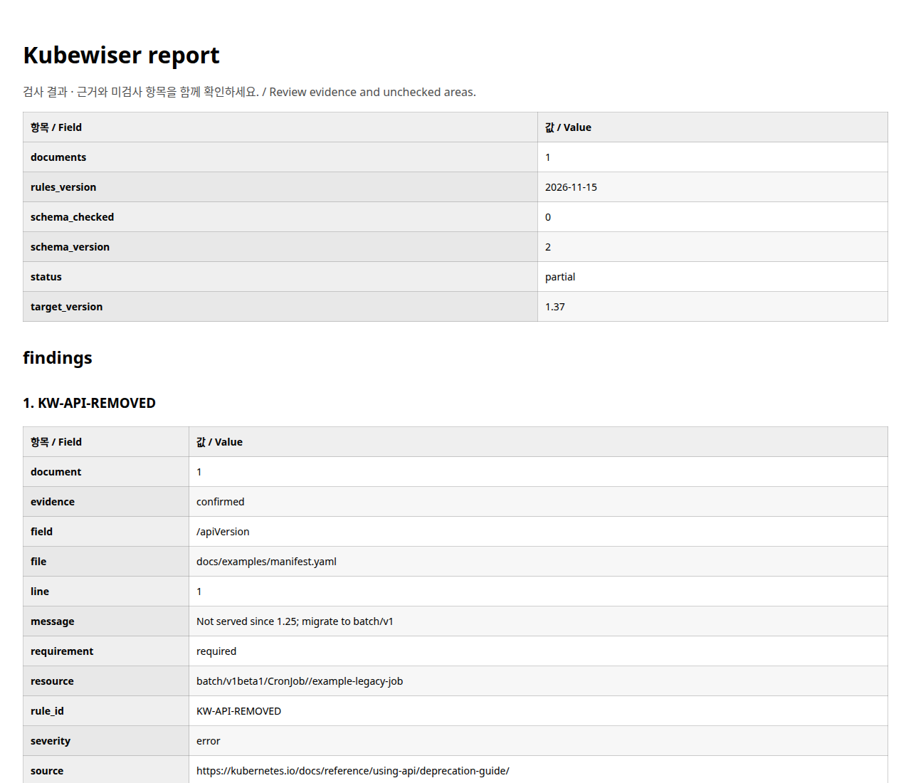

# kubewiser

[English](README.md) | **한국어**

근거 중심의 Kubernetes 검사 CLI와 로컬 MCP 서버입니다. `kubewiser`와 `kubewise`는 같은 엔진을 사용합니다. 기본 분석은 오프라인이며, 명시한 `collect` 명령 또는 별도로 활성화한 MCP 수집만 선택한 Kubernetes API 서버에 접속합니다. 텔레메트리, 자동 업데이트 확인, 문서 다운로드, 클라우드 API 호출, 리소스 변경은 하지 않습니다.

## 다운로드와 설치

[GitHub Releases](https://github.com/uknowpro/kubewiser/releases)에서 Linux/macOS amd64·arm64와 Windows 10+ amd64·386 실행 파일을 제공합니다. **사용자 환경에 Go, Helm, kubectl, WSL 설치가 필요하지 않습니다.** Windows ZIP은 EXE 하나를 포함하며 `install.ps1`이 하드링크로 두 명령을 등록합니다. 체크섬과 플랫폼 검증 범위는 [설치 문서](docs/releases.md)를 확인하세요.

## 구현 범위

| 영역 | 제공 기능 | 한계 |
| --- | --- | --- |
| 버전별 검사 | Kubernetes 1.16~1.37 `.0` 공식 스키마, 필드·타입·필수값, 로컬 CRD, API 폐기·제거 규칙 | admission 검사나 실제 앱 호환성 보증은 아님 |
| 수집 | 명시한 context/namespace, 순차 GET·페이지·속도·시간·개수 제한, 누락과 제거 필드 기록 | 허용 목록만 수집; Secret·사용자 정의 리소스·exec 인증 제외 |
| Helm·차이 비교 | 로컬 차트 렌더링, 목표 capabilities, 해시, 이름 기준 리스트 비교 | 설치·다운로드·live lookup·values.schema.json 검증·필드 소유권 추론 제외 |
| 업그레이드 | 마이너별 단계, 필수·조건부 조치, kubelet 버전 차이와 의존성 권고 | 플랫폼·애드온·실제 앱 동작은 별도 확인 |
| 네트워크·이전 | 정책 격리 의도, Service/Ingress 노출, 기존 Hubble 기록, EKS/AKS/GKE 의존성 조치 | 능동 탐사·실제 연결 보증·인프라 생성·데이터 이전 제외 |

[공식 근거](docs/official-sources.md) · [운영 범위](docs/operations.md) · [로드맵](docs/roadmap.md)

## HTML 보고서 미리보기

[실제 생성한 HTML 보고서](docs/examples/report.html)를 브라우저에서 캡처했습니다. 요약과 API 제거에 따른 필수 조치가 보이며, 아래로 스크롤하면 전체 결과를 확인할 수 있습니다. GitHub에서는 HTML 소스가 표시되므로 내려받아 브라우저로 여세요.



[Markdown 예제](docs/examples/report.md) · [예제 입력](docs/examples/manifest.yaml)

## 명령어 안내

아래의 `kubewiser`는 모두 `kubewise`로 바꿔 실행할 수 있습니다. 옵션은 입력 경로 앞에 둡니다. 예제의 경로·컨텍스트·네임스페이스는 실제 환경에 맞게 변경하세요.

예제는 저장소 루트에서 실행합니다. `docs/examples`의 입력은 문서용 가상 데이터이며 스냅샷은 Service 하나만 포함합니다. 아래 출력은 실제 CLI 실행 결과를 발췌했습니다. `$ echo $?`는 POSIX 셸 종료 코드 확인 방법이며 PowerShell에서는 `$LASTEXITCODE`를 사용합니다.

### 결과 형식과 저장

v0.2.0-alpha.2부터 `--format markdown`과 `--format html`을 지원합니다. 이전 배포판은 업데이트가 필요합니다.

| 형식 | 용도 | 저장 예시 |
| --- | --- | --- |
| `json` (기본) | 자동화·프로그램 연동 | `--format json ... > report.json` |
| `text` | 직접 scan 보고서의 간략한 터미널 출력 | `--format text ...` |
| `markdown` | GitHub·에디터에서 표와 목록으로 검토 | `--format markdown ... > report.md` |
| `html` | 브라우저에서 보고서 열기·인쇄 | `--format html ... > report.html` |

`text`의 간략 출력은 `scan files`와 `scan snapshot`에 적용되며 다른 결과는 JSON으로 표시됩니다. Markdown/HTML은 scan, diff, plan, collect 요약에 적용됩니다. `versions`는 json/markdown/html을 지원합니다. MCP는 통신 프로토콜의 구조화된 응답을 사용합니다.

```sh
# Linux/macOS: Markdown 또는 HTML 파일로 저장
kubewiser scan files --target-version 1.37 --recommend --format markdown ./deploy > report.md
kubewiser scan files --target-version 1.37 --recommend --format html ./deploy > report.html
```

```powershell
# Windows PowerShell: 한글을 보존하도록 UTF-8로 저장
kubewiser scan files --target-version 1.37 --recommend --format markdown .\deploy | Out-File -Encoding utf8 report.md
kubewiser scan files --target-version 1.37 --recommend --format html .\deploy | Out-File -Encoding utf8 report.html
Start-Process .\report.html
```

HTML은 CSS를 포함한 단일 파일이며 외부 폰트·스크립트·이미지를 불러오지 않습니다. 브라우저에서 파일을 열어 읽거나 인쇄할 수 있습니다. 두 형식은 JSON의 근거·미검사 항목을 유지하며 입력 문자열의 HTML/Markdown 문법을 이스케이프합니다. 파일에는 경로·리소스명 등 메타데이터가 포함될 수 있습니다.

실제 생성 예시: [Markdown 보고서](docs/examples/report.md), [HTML 파일](docs/examples/report.html), [예제 입력](docs/examples/manifest.yaml). GitHub에서 HTML은 소스 코드로 표시되므로 다운로드한 파일을 브라우저로 여세요.

### `--help`, `--version`, `versions` — 도움말과 지원 버전

```sh
kubewiser --help
kubewiser --version
kubewiser versions --format markdown > supported-versions.md
```

`--version`은 실행 파일의 제품 버전·커밋·운영체제를 표시합니다. `versions`는 내장 Kubernetes 스키마 버전, 공식 출처 URL, 원본·번들 SHA-256과 확인일을 보여줍니다. 예를 들어 1.37.x 요청은 내장된 1.37.0 스키마를 사용합니다.

**터미널 출력 예시** — 긴 JSON은 주요 필드만 발췌했습니다. 실제 출력에는 근거와 미검사 항목이 더 포함됩니다.

```console
$ kubewiser --help
Commands: kubewiser or kubewise
  --version
  versions [--format json|markdown|html]
  scan files --target-version VERSION [--recommend] PATH
  scan helm --target-version VERSION --release NAME --namespace NS [--values FILE] CHART
...
$ echo $?
0
```

**터미널 출력 예시** — 로컬 개발 빌드의 실제 출력입니다. 배포판은 해당 버전·커밋·플랫폼을 표시합니다.

```console
$ kubewiser --version
kubewiser dev (commit unknown; linux/amd64)
$ echo $?
0
```

**터미널 출력 예시** — 긴 JSON은 주요 필드만 발췌했습니다. 실제 출력에는 근거와 미검사 항목이 더 포함됩니다.

```console
$ kubewiser versions
[
  {
    "version": "v1.16.0",
    "source": "https://raw.githubusercontent.com/kubernetes/kubernetes/v1.16.0/api/openapi-spec/swagger.json",
    "reviewed": "2026-11-15"
  }
]
$ echo $?
0
```

### `scan files` — YAML/JSON manifest 검사

파일 하나 또는 디렉터리를 재귀 검사합니다. 스키마 오류와 API 폐기·제거 여부를 찾습니다. `--recommend`는 readiness probe, resource requests 등 조건부 권고를 추가합니다. CRD와 해당 사용자 정의 리소스를 함께 입력하면 로컬 CRD 스키마도 사용합니다.

```sh
kubewiser scan files --target-version 1.37 --format markdown ./deployment.yaml
kubewiser scan files --target-version 1.37 --recommend --format html ./deploy > manifest-report.html
```

결과에서 `findings`의 규칙 ID, 파일·줄·필드 위치, `requirement`, `severity`, `source`를 확인합니다. `schema_checked`는 스키마로 검사한 리소스 수입니다.

**터미널 출력 예시** — 긴 JSON은 주요 필드만 발췌했습니다. 실제 출력에는 근거와 미검사 항목이 더 포함됩니다.

```console
$ kubewiser scan files --target-version 1.37 --format text docs/examples/manifest.yaml
Resources: 1 | Schema-checked: 0 | Findings: 1 | Coverage: partial
KW-API-REMOVED docs/examples/manifest.yaml:1 /apiVersion required: Not served since 1.25; migrate to batch/v1
UNCHECKED: Admission, CEL, controller behavior, feature-gate availability and application runtime compatibility are not evaluated
UNCHECKED: OpenAPI validation does not replace Kubernetes admission or server semantic validation
UNCHECKED: Schemas are pinned to minor .0 releases; patch-specific changes are not inferred
$ echo $?
1
```

### `scan helm` — 로컬 Helm 차트 렌더링 후 검사

압축을 푼 로컬 차트와 이미 준비된 의존 차트가 필요합니다. `--release`, `--namespace`, `--values`로 렌더링 조건을 고정합니다. Helm 설치는 필요하지 않으며 의존 차트 다운로드, live lookup, 리소스 적용은 하지 않습니다.

```sh
kubewiser scan helm --target-version 1.37 --release app --namespace team --values ./values.yaml --format markdown ./chart > helm-report.md
```

`render`에는 차트 버전·values 해시·capabilities가, `report`에는 검사 결과가 나옵니다. `--api-versions v1,apps/v1,example.org/v1/Widget`은 기본 capabilities를 **교체**하므로 필요한 전체 목록을 명시해야 합니다. values.schema.json 검증은 수행하지 않습니다.

**터미널 출력 예시** — 긴 JSON은 주요 필드만 발췌했습니다. 실제 출력에는 근거와 미검사 항목이 더 포함됩니다.

```console
$ kubewiser scan helm --target-version 1.37 --release app --namespace team docs/examples/chart
{
  "render": {
    "chart": "demo",
    "chart_version": "0.1.0",
    "release": "app",
    "namespace": "team",
    "target_version": "1.37"
  },
  "report": {
    "documents": 1,
    "schema_checked": 1,
    "findings": [],
    "status": "partial"
  }
}
$ echo $?
0
```

### `collect` — 읽기 전용 스냅샷 수집

선택한 API 서버에서 지정한 namespace의 허용된 리소스만 GET으로 수집합니다. 이 명령은 네트워크에 접근합니다. kubeconfig·context·namespace·새 출력 파일 경로를 명시해야 합니다.

```sh
kubewiser collect --kubeconfig ./config --context staging --namespace team --output ./snapshot.json --format markdown > collection-summary.md
# Node와 StorageClass도 포함하고, 초당 요청 수와 전체 제한을 지정
kubewiser collect --kubeconfig ./config --context staging --namespace team --include-cluster-resources --qps 1 --max-items 3000 --timeout 3m --output ./snapshot-with-nodes.json --format html > collection-summary.html
```

`--output` 파일은 후속 분석용 **JSON 스냅샷**이고, 표준 출력은 수집 개수·요청 수·누락(`gaps`)·제거한 필드 수의 **요약**입니다. `--format`은 요약 형식만 바꿉니다. 기존 스냅샷 파일은 덮어쓰지 않습니다. Secret은 수집하지 않으며 지정된 민감 필드를 제거합니다. 인증 exec 플러그인은 지원하지 않습니다. 자세한 허용 목록과 한도는 [운영 문서](docs/operations.md)를 확인하세요.

**터미널 출력 예시** — 로컬 모의 API 서버의 빈 리소스 응답으로 실행한 예시입니다. 임시 출력 경로만 snapshot.json으로 표기했습니다. 실제 클러스터의 수치가 아닙니다.

```console
$ kubewiser collect --kubeconfig ./config --context demo --namespace team --qps 10 --output snapshot.json
{
  "gaps": [
    {
      "resource": "coverage",
      "reason": "Secrets, custom resources, unlisted kinds and other namespaces are not collected"
    }
  ],
  "output": "snapshot.json",
  "redacted_fields": 0,
  "requests": 13,
  "resources": 0
}
$ echo $?
0
```

### `scan snapshot` — 저장된 스냅샷의 목표 버전 검사

클러스터에 다시 접속하지 않고 저장된 리소스를 검사합니다.

```sh
kubewiser scan snapshot --target-version 1.37 --recommend --format html ./snapshot.json > snapshot-report.html
```

수집 누락과 제거된 필드는 `unchecked`에 함께 표시됩니다. 스냅샷에 없는 종류의 리소스까지 검증된 것으로 해석하지 마세요.

**터미널 출력 예시** — 긴 JSON은 주요 필드만 발췌했습니다. 실제 출력에는 근거와 미검사 항목이 더 포함됩니다.

```console
$ kubewiser scan snapshot --target-version 1.37 --format text docs/examples/snapshot.json
Resources: 1 | Schema-checked: 1 | Findings: 0 | Coverage: partial
UNCHECKED: Admission, CEL, controller behavior, feature-gate availability and application runtime compatibility are not evaluated
UNCHECKED: OpenAPI validation does not replace Kubernetes admission or server semantic validation
UNCHECKED: Schemas are pinned to minor .0 releases; patch-specific changes are not inferred
UNCHECKED: coverage: Synthetic documentation fixture: only one Service included
UNCHECKED: Redacted fields may not be schema-validated
$ echo $?
0
```

### `diff` — 원하는 상태와 수집한 상태 비교

manifest 경로(`--source`) 또는 Helm 차트(`--chart`) 중 하나와 `--snapshot`을 지정합니다. namespace를 생략하면 스냅샷의 namespace를 사용합니다.

```sh
kubewiser diff --source ./deploy --snapshot ./snapshot.json --format markdown > drift.md
kubewiser diff --chart ./chart --target-version 1.37 --release app --values ./values.yaml --snapshot ./snapshot.json --format html > drift.html
```

| 결과 종류 | 해석 |
| --- | --- |
| `changed` | 선언값과 관측값이 다름; 실제 값은 출력하지 않음 |
| `desired_only_field` | 선언한 필드가 스냅샷에 없음 |
| `observed_only_field` | 스냅샷에만 있음; 기본값·컨트롤러 추가 여부 확인 필요 |
| `not_observed` | 스냅샷에서 발견되지 않음; 삭제 외에도 범위·권한 누락 가능 |
| `observed_only_resource` | 제공한 manifest 집합 밖의 리소스; 삭제 권고가 아님 |
| `conversion_unverified` | API 버전이 달라 의미 비교 전에 변환 검증 필요 |

**터미널 출력 예시** — 긴 JSON은 주요 필드만 발췌했습니다. 실제 출력에는 근거와 미검사 항목이 더 포함됩니다.

```console
$ kubewiser diff --source docs/examples/desired.yaml --snapshot docs/examples/snapshot.json
{
  "changes": [
    {
      "resource": "/Service/team/web",
      "path": "/spec/ports",
      "type": "changed",
      "message": "Declared and observed values differ; values omitted"
    }
  ]
}
$ echo $?
1
```

### `plan upgrade` — 버전 업그레이드 조치 목록

현재 버전 `--from`과 목표 버전 `--to`, `--source` 또는 `--snapshot` 중 하나를 지정합니다. 목표 마이너 버전은 더 높아야 합니다.

```sh
kubewiser plan upgrade --source ./deploy --from 1.35 --to 1.37 --format markdown > upgrade-plan.md
kubewiser plan upgrade --snapshot ./snapshot-with-nodes.json --from 1.35 --to 1.37 --format html > upgrade-plan.html
```

`steps`는 마이너별 진행 순서, `actions`는 조치·필수 여부·검증 방법·근거입니다. Node가 있으면 kubelet 버전 차이도 확인합니다. 애드온·실제 앱 동작·커널 호환성이 자동 검증되는 것은 아닙니다.

**터미널 출력 예시** — 긴 JSON은 주요 필드만 발췌했습니다. 실제 출력에는 근거와 미검사 항목이 더 포함됩니다.

```console
$ kubewiser plan upgrade --source docs/examples/manifest.yaml --from 1.24 --to 1.26
{
  "kind": "upgrade",
  "from": "1.24",
  "to": "1.26",
  "steps": [
    "1.25: verify provider/add-on prerequisites, upgrade control plane, then compatible node components, then validate workloads",
    "1.26: verify provider/add-on prerequisites, upgrade control plane, then compatible node components, then validate workloads"
  ],
  "actions": [
    {
      "id": "KW-API-REMOVED",
      "resource": "batch/v1beta1/CronJob//example-legacy-job",
      "requirement": "required",
      "message": "Not served since 1.25; migrate to batch/v1",
      "verification": "Re-run target validation and test workload behavior in staging",
      "source": "https://kubernetes.io/docs/reference/using-api/deprecation-guide/",
      "before_version": "1.26"
    }
  ]
}
$ echo $?
0
```

### `scan network` — 설정과 기존 통신 기록 분석

manifest 또는 스냅샷을 읽어 Service/Ingress 노출과 NetworkPolicy 격리 의도를 확인합니다. `--flows`는 선택 사항이며 기존 Hubble JSON Lines 파일을 추가 분석합니다.

```sh
kubewiser scan network --namespace team --format markdown ./deploy > network-policy.md
kubewiser scan network --snapshot ./snapshot.json --flows ./hubble.jsonl --format html > network-report.html
```

`exposures`는 설정상 노출, `isolation`은 정책의 ingress/egress 격리 의도, `observed_flows`는 관측된 통신·판정·횟수·시간입니다. 능동 포트 스캔이나 에이전트 설치를 하지 않으며 실제 연결 가능 여부를 확정하지 않습니다.

**터미널 출력 예시** — 긴 JSON은 주요 필드만 발췌했습니다. 실제 출력에는 근거와 미검사 항목이 더 포함됩니다.

```console
$ kubewiser scan network --snapshot docs/examples/snapshot.json --flows docs/examples/hubble.jsonl
{
  "exposures": [
    {
      "resource": "v1/Service/team/web",
      "type": "LoadBalancer",
      "evidence": "configured exposure, not reachability tested"
    }
  ],
  "observed_flows": [
    {
      "source": "team/web",
      "destination": "team/db",
      "verdict": "FORWARDED",
      "count": 1,
      "first_observed": "2026-11-15T00:00:00Z",
      "last_observed": "2026-11-15T00:00:00Z"
    }
  ]
}
$ echo $?
0
```

### `plan migrate` — 클라우드 이전 의존성 확인

`eks`, `aks`, `gke` 중 서로 다른 출발·대상 플랫폼을 지정합니다. 스토리지, 로드밸런서, 워크로드 ID, 플랫폼 종속 설정 등을 조치 목록으로 정리합니다.

```sh
kubewiser plan migrate --source ./deploy --from eks --to aks --format markdown > migration-plan.md
kubewiser plan migrate --snapshot ./snapshot.json --from aks --to gke --format html > migration-plan.html
```

클라우드 API 호출·인프라 생성·데이터 이전은 수행하지 않습니다. 스냅샷에서는 annotation이 제거되므로 플랫폼별 annotation 검토에는 원본 manifest가 더 적합합니다.

**터미널 출력 예시** — 긴 JSON은 주요 필드만 발췌했습니다. 실제 출력에는 근거와 미검사 항목이 더 포함됩니다.

```console
$ kubewiser plan migrate --source docs/examples/desired.yaml --from eks --to aks
{
  "kind": "migration",
  "from": "eks",
  "to": "aks",
  "actions": [
    {
      "id": "KW-MIGRATE-LB",
      "resource": "v1/Service/team/web",
      "requirement": "required",
      "message": "Recreate provider load balancer configuration, annotations and health checks; verify client IP and exposure",
      "verification": "Validate target provider configuration and test in staging before cutover",
      "source": "https://learn.microsoft.com/en-us/azure/aks/what-is-aks"
    }
  ]
}
$ echo $?
0
```

### `mcp` — 로컬 모델용 검사 도구 서버

```sh
kubewiser mcp --input /absolute/path/deploy --snapshot /absolute/path/snapshot.json --namespace team
# Helm과 기존 네트워크 기록도 도구에 연결
kubewiser mcp --input /absolute/path/deploy --chart /absolute/path/chart --values /absolute/path/values.yaml --flows /absolute/path/hubble.jsonl --namespace team
```

MCP 클라이언트가 위 명령을 프로세스로 실행하도록 설정합니다. 일반 보고서 생성 명령과 달리 요청을 기다리는 stdio 서버이며 `> report.md`로 저장하는 명령이 아닙니다. 상세 도구와 로컬 모델 연동은 다음 절을 참고하세요.

**터미널에서 직접 실행했을 때**

```console
$ kubewiser mcp --input docs/examples/desired.yaml --snapshot docs/examples/snapshot.json --namespace team
```

요청을 기다리는 동안 배너나 보고서를 출력하지 않습니다. MCP 클라이언트가 이 프로세스를 실행하도록 설정하며, 수동 실행을 끝내려면 Ctrl+C를 누릅니다.

### 결과 해석과 종료 코드

| 항목 | 의미 |
| --- | --- |
| `required` | 필수 조치 |
| `conditional` | 해당 조건에 맞는지 확인한 뒤 조치 |
| `optional` | 측정·운영 요구를 고려한 권고 |
| `severity` | 오류·경고 등 심각도; 필수 여부와 별개 |
| `source` / `evidence` | 근거 문서와 판정 근거 수준 |
| `unchecked` / `gaps` | 검사하지 못한 영역·수집 누락 |
| `status: partial` | 전체 호환성 보증이 아닌 범위가 제한된 검사 |

scan은 발견 사항이 없으면 `0`, 있으면 `1`, 인자·실행 오류는 `2`입니다. diff는 차이가 있으면 `1`입니다. collect/plan/network는 성공 시 조치·누락이 있어도 `0`입니다. **종료 코드 0은 전체 호환성 보증이 아닙니다.** 발견 사항이 있어 `1`로 종료해도 Markdown/HTML 보고서는 생성됩니다. 셸의 `>`는 기존 보고서를 덮어쓰므로 보관할 파일명은 구분하세요.

## 로컬 MCP와 로컬 모델

MCP 지원 클라이언트를 통해 로컬 DeepSeek/Ollama 모델과 연결할 수 있습니다. kubewiser 자체는 LLM을 실행하거나 호출하지 않습니다. 기본 도구는 `scan_files`, `plan_upgrade`, `plan_migrate`, `scan_network`입니다. `compare_drift`는 input과 snapshot, `scan_helm`은 chart 설정이 필요합니다. 파일 경로와 클러스터 범위는 시작할 때 운영자가 고정하며 모델이 변경할 수 없습니다.

수집 도구는 기본으로 제공하지 않습니다. `--allow-cluster`로 활성화하려면 `--kubeconfig`, `--context`, `--namespace`도 명시해야 합니다. 수집 결과는 지정 필드를 제거한 스냅샷으로 MCP 클라이언트에 전달됩니다. 클라이언트·모델이 데이터를 외부로 보낼 수 있으므로 외부 전송을 금지하려면 로컬 전용 클라이언트 설정을 사용하세요. 경로·해시·리소스명·IP와 남은 메타데이터도 민감할 수 있습니다. 신뢰할 수 있는 로컬 차트와 manifest를 입력하세요.

## 빌드와 개발

소스 빌드에는 Go 1.26 이상이 필요하며 CI 도구체인은 `.go-version`에 고정합니다. 배포 실행 파일 사용에는 Go 설치가 필요하지 않습니다.

```sh
go build -o kubewiser ./cmd/kubewiser
go test -race ./...
go vet ./...
```

의존성과 내장 공식 스키마의 라이선스는 [THIRD_PARTY_NOTICES.txt](THIRD_PARTY_NOTICES.txt)를 확인하세요. 보고서 형식은 v2이며 이전 알파 보고서를 처리하던 프로그램은 파서를 업데이트해야 합니다.
