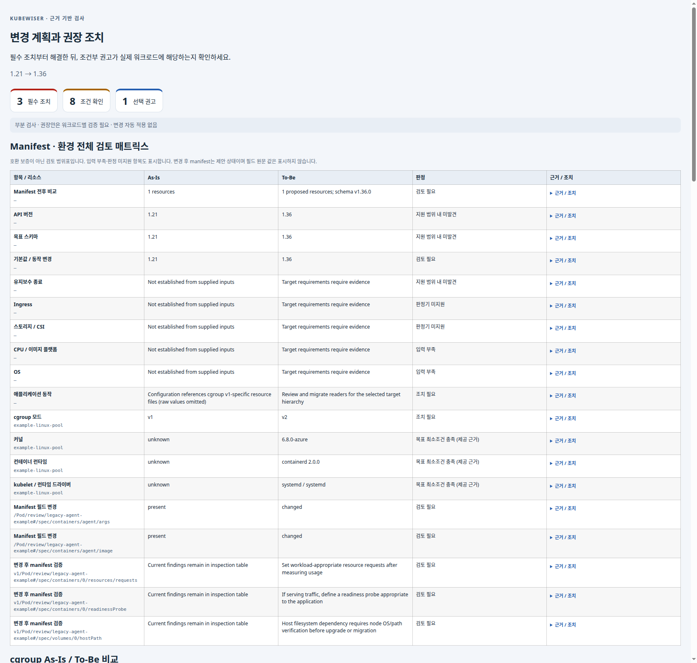
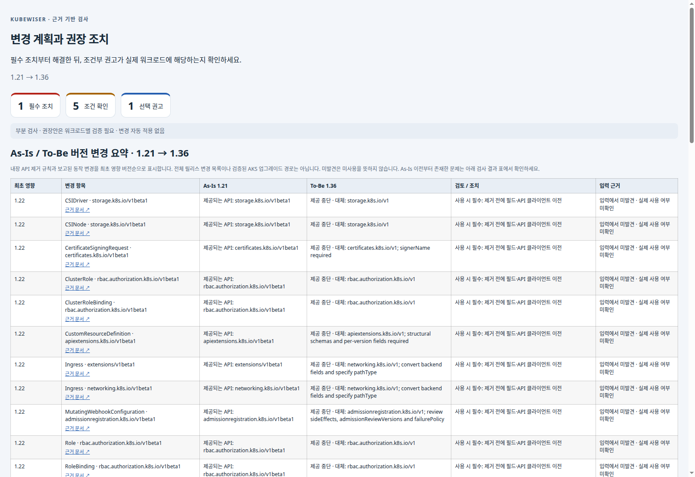

# kubewiser

[English](README.md) | **한국어**

**Kubernetes 변경 전에, 무엇을 고쳐야 하는지 확인하세요.**

manifest, Helm 차트, 읽기 전용 스냅샷을 검사하고 **현재 상태 → 권장 상태 → 다음 조치**를 비교하는 CLI입니다. 목표 버전의 공식 스키마와 근거 문서를 사용하며, 로컬 분석과 MCP 연결을 지원합니다.

[다운로드](https://github.com/uknowpro/kubewiser/releases) · [빠른 시작](#빠른-시작) · [보고서 미리보기](#보고서-미리보기) · [명령어 안내](#명령어-안내) · [로드맵](docs/roadmap.md)

> 알파 버전입니다. 기본 검사는 오프라인이며 텔레메트리가 없습니다. 명시적인 수집은 선택한 API 서버에 접근하며, 외부 인증 옵션을 켜면 인증 서버 통신도 발생할 수 있습니다. 결과는 부분 검사이며 변경을 자동 적용하지 않습니다.

## 📑 목차

- [✨ 주요 기능](#주요-기능)
- [📊 보고서 미리보기](#보고서-미리보기)
- [🧮 전후 비교 매트릭스](#comparison-matrix)
- [🚀 빠른 시작](#빠른-시작)
- [📦 설치](#설치)
- [🛠️ 명령어 한눈에 보기](#명령어-한눈에-보기)
- [📖 명령어 안내](#명령어-안내)
- [🤖 로컬 MCP와 로컬 모델](#로컬-mcp와-로컬-모델)
- [🔧 빌드와 개발](#빌드와-개발)
- [🔎 검증 범위와 근거](#검증-범위와-근거)
- [💬 개발과 피드백](#개발과-피드백)
- [🗺️ 로드맵](docs/roadmap.md)
- [📝 릴리스 노트](https://github.com/uknowpro/kubewiser/releases)
- [📄 라이선스](LICENSE)

<a id="주요-기능"></a>

## ✨ 주요 기능

| 기능 | 할 수 있는 일 |
| --- | --- |
| 🔍 Manifest·API 검사 | Kubernetes 1.16~1.37 `.0`·일부 정확한 패치 스키마와 제공한 로컬 CRD로 스키마 오류, API 폐기·제거 여부를 확인합니다. |
| 🎯 실행 가능한 권장안 | 필수·조건부·선택 조치를 구분하고 현재·권장 상태, 변경 이유와 검증 방법을 비교합니다. |
| 🧮 전후 비교 매트릭스 | 현재·제안 manifest 차이와 목표 검증, cgroup·커널·런타임의 검토 상태를 한 표에서 확인합니다. |
| ⚖️ Helm·manifest 차이 비교 | 로컬 차트를 렌더링하고 원하는 상태와 명시한 범위의 GET 전용 스냅샷을 비교합니다. |
| 🪜 업그레이드 계획 | 마이너 버전별 단계와 워크로드 API 변경을 검토합니다. 플랫폼의 업그레이드 가능 여부와 실제 동작은 별도 검증이 필요합니다. |
| ☁️ 클라우드 이전 검토 | EKS/AKS/GKE의 스토리지·로드밸런서·ID 의존성을 정리합니다. 클라우드 간 인프라 생성·데이터 이전은 수행하지 않으며 AKS 검토 초안 생성은 별도로 제공합니다. |
| 🌐 네트워크 의도 분석 | 능동 탐침 없이 Service/Ingress 노출, NetworkPolicy 격리 의도와 기존 Hubble 기록을 확인합니다. |
| 📊 공유 가능한 보고서 | 터미널 요약과 JSON·Markdown·독립 HTML로 근거와 미검사 영역을 함께 확인합니다. |
| 🤖 로컬 MCP 연동 | 로컬 DeepSeek/Ollama 모델을 사용하는 MCP 클라이언트 등에 범위가 제한된 검사 도구를 제공합니다. 자체 LLM 호출은 없습니다. |
| 🔒 오프라인 분석 | 텔레메트리·자동 다운로드 없이 로컬 입력을 분석합니다. 명시적인 수집만 선택한 Kubernetes API 서버에 접근합니다. |

<a id="보고서-미리보기"></a>

## 📊 보고서 미리보기

합성 예제 입력으로 생성한 최신 보고서입니다. 전체 검토 매트릭스를 먼저 보여주고 cgroup·지원 종료·버전 변경·검사 결과 표가 이어집니다. 상세 근거는 펼쳐서 확인할 수 있습니다.

<a id="comparison-matrix"></a>

### Manifest · 환경 전후 비교 매트릭스 (v0.2.0-alpha.12)

`plan upgrade`와 `plan aks`는 전체 검토표를 제공합니다. HTML은 그룹과 리소스·노드풀 셀을 세로 병합하며 항목별 판정은 유지합니다. Markdown·터미널도 같은 그룹 순서로 보여줍니다. cgroup·커널·런타임·드라이버 자료가 없으면 **입력 부족**, 아직 판정기가 없는 항목은 **판정기 미지원**으로 표시합니다. `--after`를 생략하면 목표 구성은 권장안이며 실제 변경 후 상태로 취급하지 않습니다.

```bash
kubewiser plan upgrade --source ./before --after ./after \
  --from 1.21 --to 1.36 --cgroup-evidence ./pools.json \
  --format html --lang ko > comparison.html
```

노드풀별 워크로드 영향, PDB·drain 위험과 **해결됨 / 남아 있음 / 새로 발생 / 비교 불가** 추적을 추가했습니다. [입력·판정 범위와 실행 예시](docs/upgrade-readiness.md). 실제 drain이나 배포는 수행하지 않습니다.

[사용법·판정 범위](docs/matrix.md) · [HTML 결과](docs/examples/matrix.ko.html) · [현재 입력](docs/examples/readiness/before.yaml) · [변경 후 입력](docs/examples/readiness/after.yaml)



### Dockerfile 자동 검사 (v0.2.0-alpha.13)

`scan cgroup`, `plan upgrade`, `plan aks`는 **추가 옵션 없이 `--source` 범위의 Dockerfile/Containerfile을 자동 검사**합니다. 폴더는 하위 경로까지, manifest 파일은 같은 폴더만 검사합니다. Java 베이스 태그의 cgroup v2 지원 기준, v1 전용 파일 참조, `-XX:-UseContainerSupport`를 파일·단계·줄 번호별로 매트릭스와 기존 결과표에 표시합니다.

```sh
kubewiser plan upgrade --source ./project --from 1.21 --to 1.36 --format html --lang ko > upgrade.html
```

찾지 못한 Dockerfile·불명확한 태그·지원하지 않는 문법은 **입력 부족/판정기 미지원**입니다. 태그가 기준을 충족해도 실제 이미지 호환성을 보증하지 않습니다. [자동 검색 범위·제약·Windows 저장 예시](docs/dockerfile.md) · [HTML 예제](docs/examples/dockerfile/report.ko.html)

### cgroup 현재·목표 비교 (v0.2.0-alpha.8)

노드풀별 v1/v2/혼합 모드를 비교하고, 근거 충돌·미확인·커널/런타임/드라이버 조건·워크로드의 v1 의존 단서를 표로 표시합니다. [근거 입력과 검사 범위](docs/cgroup.md). 실제 노드 명령은 실행하지 않습니다.

```sh
kubewiser plan upgrade --source ./deploy --from 1.21 --to 1.36 --cgroup-evidence ./pools.json --format html --lang ko > upgrade-review.html
```

### 지원 종료 검사 (v0.2.0-alpha.7)

프로젝트·관리형 애드온·AKS 노드 OS의 지원 종료와 종료 예정을 별도 표로 확인합니다. 관리형 지원과 커뮤니티 지원을 구분하고 식별이 불확실하면 확인 필요로 표시합니다. [검사 범위와 7개 카탈로그 항목](docs/lifecycle.md).

```sh
kubewiser scan lifecycle --source ./deploy --format html --lang ko > lifecycle.html
```

### 표 중심 마이그레이션 검토 (v0.2.0-alpha.6)

HTML 결과는 행 단위 표로 표시하며 상세 근거는 펼쳐볼 수 있습니다. 업그레이드·AKS 계획에는 내장 API 제거 규칙과 동작 변경을 모은 As-Is/To-Be 표도 표시합니다. 전체 릴리스 변경 목록이나 실제 클러스터 사용 현황을 보증하는 표는 아닙니다.

```sh
kubewiser plan upgrade --source ./deploy --from 1.21 --to 1.36 --format html --lang ko > upgrade-1.21-1.36.html
```

[1.21 → 1.36 HTML 예시](docs/examples/upgrade-1.21-1.36.ko.html) — 저장소 예제 입력으로 생성했으며 다운로드 후 브라우저로 확인하세요. v0.2.0-alpha.6부터 사용할 수 있습니다.



HTML은 내려받아 브라우저로 여세요. 외부 폰트·스크립트 없이 파일 하나로 동작합니다.

<a id="빠른-시작"></a>

## 🚀 빠른 시작

1. [Releases](https://github.com/uknowpro/kubewiser/releases)에서 운영체제에 맞는 압축 파일을 받아 체크섬을 확인하고 풉니다.
2. 실행 파일을 PATH에 등록하거나 해당 폴더에서 `./kubewiser`(Windows: `.\kubewiser.exe`)로 실행합니다.
3. 아래 명령으로 검사하고 보고서를 엽니다. **Go·Helm·kubectl 설치는 필요하지 않습니다.**

```sh
kubewiser --version
kubewiser scan files --target-version 1.37 --recommend --format text --lang ko ./deploy
kubewiser scan files --target-version 1.37 --recommend --format html --lang ko ./deploy > report.html
```

예를 들어 구형 CronJob을 검사하면 다음처럼 표시됩니다. 실제 출력 중 핵심 줄을 발췌했습니다.

```console
$ kubewiser scan files --target-version 1.37 --format text --lang ko docs/examples/manifest.yaml
검사 결과와 권장 조치
목표 Kubernetes 1.37 · 리소스 1개 · 스키마 검사 0개
...
필수 조치: 1 | 조건 확인: 0 | 선택 권고: 0

1. [필수 조치] Kubernetes API 이전 (KW-API-REMOVED)
   batch/v1beta1/CronJob//example-legacy-job
   현재: apiVersion: batch/v1beta1
   권장: batch/v1
...
```

발견 사항이 있으면 종료 코드는 `1`이며 보고서는 정상 생성됩니다. 미검사 항목도 반드시 확인하세요.

<a id="설치"></a>

## 📦 설치

| 환경 | 배포 파일 |
| --- | --- |
| Linux Intel/AMD · ARM64 | `linux_amd64.tar.gz` · `linux_arm64.tar.gz` |
| macOS Intel · Apple Silicon | `darwin_amd64.tar.gz` · `darwin_arm64.tar.gz` |
| Windows 10+ 64비트 · 32비트 | `windows_amd64.zip` · `windows_386.zip` |

파일 이름에는 릴리스 버전도 포함됩니다. `kubewiser`와 `kubewise`는 같은 명령입니다. Windows ZIP에는 EXE 하나와 `install.ps1`이 포함됩니다. 설치 스크립트를 실행하면 사용자 PATH와 두 명령을 등록합니다.

```powershell
.\install.ps1
kubewiser scan files --target-version 1.37 --format html --lang ko .\deploy | Out-File -Encoding utf8 report.html
Start-Process .\report.html
```

체크섬·설치·OS 검증 범위는 [설치 안내](docs/releases.md)를 참고하세요.

<a id="명령어-한눈에-보기"></a>

## 🛠️ 명령어 한눈에 보기

| 명령 | 용도 |
| --- | --- |
| `scan files` | 파일·디렉터리 검사 |
| `scan cgroup` | 현재·목표 cgroup 모드 및 전환 영향 비교 |
| `scan lifecycle` | 지원 종료·종료 예정·식별 필요 검사 |
| `scan cel` | 로컬 CRD CEL·변경 규칙 검사 |
| `scan helm` | 로컬 차트 렌더링 후 검사 |
| `collect` | 선택한 클러스터·namespace에서 스냅샷 수집 |
| `scan snapshot` | 저장한 리소스의 목표 버전 검사 |
| `diff` | manifest/Helm과 스냅샷 비교 |
| `plan upgrade` | 단계별 업그레이드 조치 |
| `plan aks` / `generate` | AKS 프로젝트 검토 / 로컬 검토 초안 생성 |
| `scan path` | 두 Pod의 ingress·egress 정책 의도 분석 |
| `scan network` | 설정과 기존 네트워크 기록 분석 |
| `plan migrate` | 클라우드 이전 의존성 검토 |
| `mcp` | 로컬 MCP 검사 도구 서버 |
| `versions` / `--version` / `--help` | 스키마 목록 / 실행 파일 정보 / 도움말 |

아래 항목을 펼치면 실행 명령·터미널 출력·종료 코드까지 확인할 수 있습니다.

### 현재 버전과 목표 버전 지정

`--from`은 현재 버전, `--to`는 목표 버전입니다. 로컬 manifest는 `--source`, 저장된 스냅샷은 `--snapshot`으로 지정하며 둘 중 하나만 사용합니다.

```sh
kubewiser plan upgrade --source ./deploy --from 1.21 --to 1.36 --format html --lang ko > upgrade-review.html
kubewiser plan upgrade --snapshot ./snapshot.json --from 1.21 --to 1.36 --format html --lang ko > snapshot-review.html
```

AKS 프로젝트에서는 기존 프로필의 `from_version`과 `to_version`을 수정합니다. 아래는 **전체 프로필이 아닌 해당 필드 발췌**입니다.

```json
{
  "from_version": "1.21",
  "to_version": "1.36"
}
```

```sh
kubewiser plan aks --snapshot ./snapshot.json --profile ./project.json --format html --lang ko > aks-review.html
```

위 명령은 로컬 보고서만 생성하며 실제 업그레이드를 실행하지 않습니다. 마이너 버전 순서는 실제 AKS에서 제공되는 업그레이드 경로를 보증하지 않습니다.

### AKS 프로젝트 계획 (v0.2.0-alpha.4 이상)

```sh
kubewiser plan aks --source ./deploy --profile docs/examples/project/aks.json --format html --lang ko > aks-plan.html
kubewiser generate --profile docs/examples/project/aks.json --output ./new-review-drafts
kubewiser scan path --source ./network-inputs --source-pod team/client --destination-pod team/api --port 8080
```

[요구사항 프로필·아키텍처 변경·템플릿·네트워크 경로 안내](docs/project-planning.md). 1.21 → 1.35는 요구사항 예제이며 AKS가 지원하는 실제 경로로 검증한 것이 아닙니다. 생성물은 검토용 초안이고 인프라 작업을 실행하지 않습니다.

### 추가 고도화 검사 (v0.2.0-alpha.5 이상)

```sh
kubewiser scan files --target-version 1.35.9 ./deploy
kubewiser scan cel --source ./crds-and-resources --format html --lang ko > cel.html
kubewiser diff --source ./deploy --snapshot ./snapshot.json --crd-defaults --crd-conversion
kubewiser scan path --source ./network-inputs --source-pod team/client --destination-service team/api --port 443 --flows ./hubble.jsonl
```

[인증·AKS 조회 근거·패치 스키마·CEL·이미지 플랫폼·설정 기반 템플릿 안내](docs/advanced-inspection.md). 아래 기존 터미널 발췌는 alpha.3/alpha.4에서 기록했으며 최신 버전의 진단 문구와 다를 수 있습니다.

<a id="명령어-안내"></a>

## 📖 명령어 안내

아래의 `kubewiser`는 모두 `kubewise`로 바꿔 실행할 수 있습니다. 옵션은 입력 경로 앞에 둡니다. 예제의 경로·컨텍스트·네임스페이스는 실제 환경에 맞게 변경하세요.

예제는 저장소 루트에서 실행합니다. `docs/examples`의 입력은 문서용 가상 데이터이며 스냅샷은 Service 하나만 포함합니다. 아래 출력은 실제 CLI 실행 결과를 발췌했습니다. `$ echo $?`는 POSIX 셸 종료 코드 확인 방법이며 PowerShell에서는 `$LASTEXITCODE`를 사용합니다.


<details>
<summary>결과 형식과 저장</summary>

v0.2.0-alpha.2부터 Markdown/HTML을 지원하며, v0.2.0-alpha.3부터 scan/plan/diff에 권장 비교와 `--lang en|ko`를 제공합니다. 원본 JSON과 미검사 근거는 유지합니다. 한국어 옵션은 읽기용 설명을 번역하며 원본 근거 문구는 영어로 남을 수 있습니다.

| 형식 | 용도 | 저장 예시 |
| --- | --- | --- |
| `json` (기본) | 자동화·프로그램 연동 | `--format json ... > report.json` |
| `text` | 직접 scan 보고서의 간략한 터미널 출력 | `--format text ...` |
| `markdown` | GitHub·에디터에서 표와 목록으로 검토 | `--format markdown ... > report.md` |
| `html` | 브라우저에서 보고서 열기·인쇄 | `--format html ... > report.html` |

`text`는 scan files/snapshot/helm, diff, plan에서 현재·권장 상태와 조치를 표시합니다. network와 collect 결과는 JSON으로 표시됩니다. Markdown/HTML은 scan, diff, plan, collect 요약에 적용됩니다. `versions`는 json/markdown/html을 지원합니다. MCP는 통신 프로토콜의 구조화된 응답을 사용합니다.

```sh
# Linux/macOS: Markdown 또는 HTML 파일로 저장
kubewiser scan files --target-version 1.37 --recommend --format markdown ./deploy > report.md
kubewiser scan files --target-version 1.37 --recommend --format html ./deploy > report.html
```

```powershell
# Windows PowerShell: 한글을 보존하도록 UTF-8로 저장
kubewiser scan files --target-version 1.37 --recommend --format markdown .\deploy | Out-File -Encoding utf8 report.md
kubewiser scan files --target-version 1.37 --recommend --format html .\deploy | Out-File -Encoding utf8 report.html
Start-Process .\report.html
```

HTML은 CSS를 포함한 단일 파일이며 외부 폰트·스크립트·이미지를 불러오지 않습니다. 브라우저에서 파일을 열어 읽거나 인쇄할 수 있습니다. 두 형식은 JSON의 근거·미검사 항목을 유지하며 입력 문자열의 HTML/Markdown 문법을 이스케이프합니다. 파일에는 경로·리소스명 등 메타데이터가 포함될 수 있습니다.

실제 생성 예시: [Markdown 보고서](docs/examples/report.md), [HTML 파일](docs/examples/report.html), [예제 입력](docs/examples/manifest.yaml). GitHub에서 HTML은 소스 코드로 표시되므로 다운로드한 파일을 브라우저로 여세요.

</details>

<details>
<summary>--help, --version, versions — 도움말과 지원 버전</summary>

```sh
kubewiser --help
kubewiser --version
kubewiser versions --format markdown > supported-versions.md
```

`--version`은 실행 파일의 제품 버전·커밋·운영체제를 표시합니다. `versions`는 내장 Kubernetes 스키마 버전, 공식 출처 URL, 원본·번들 SHA-256과 확인일을 보여줍니다. 내장된 정확한 패치(1.35.9·1.36.5·1.37.1)를 우선 사용하고, 나머지 패치는 `.0`을 사용했다고 표시합니다.

**터미널 출력 예시** — 긴 JSON은 주요 필드만 발췌했습니다. 실제 출력에는 근거와 미검사 항목이 더 포함됩니다.

```console
$ kubewiser --help
Commands: kubewiser or kubewise
  --version
  versions [--format json|markdown|html]
  scan files --target-version VERSION [--recommend] PATH
  scan helm --target-version VERSION --release NAME --namespace NS [--values FILE] CHART
...
$ echo $?
0
```

**터미널 출력 예시** — 로컬 개발 빌드의 실제 출력입니다. 배포판은 해당 버전·커밋·플랫폼을 표시합니다.

```console
$ kubewiser --version
kubewiser dev (commit unknown; linux/amd64)
$ echo $?
0
```

**터미널 출력 예시** — 긴 JSON은 주요 필드만 발췌했습니다. 실제 출력에는 근거와 미검사 항목이 더 포함됩니다.

```console
$ kubewiser versions
[
  {
    "version": "v1.16.0",
    "source": "https://raw.githubusercontent.com/kubernetes/kubernetes/v1.16.0/api/openapi-spec/swagger.json",
    "reviewed": "2026-11-15"
  }
]
$ echo $?
0
```

</details>

<details>
<summary>scan files — YAML/JSON manifest 검사</summary>

파일 하나 또는 디렉터리를 재귀 검사합니다. 스키마 오류와 API 폐기·제거 여부를 찾습니다. `--recommend`는 readiness probe, resource requests 등 조건부 권고를 추가합니다. CRD와 해당 사용자 정의 리소스를 함께 입력하면 로컬 CRD 스키마도 사용합니다.

```sh
kubewiser scan files --target-version 1.37 --format markdown ./deployment.yaml
kubewiser scan files --target-version 1.37 --recommend --format html ./deploy > manifest-report.html
```

결과에서 `findings`의 규칙 ID, 파일·줄·필드 위치, `requirement`, `severity`, `source`를 확인합니다. `schema_checked`는 스키마로 검사한 리소스 수입니다.

**터미널 출력 예시** — 긴 JSON은 주요 필드만 발췌했습니다. 실제 출력에는 근거와 미검사 항목이 더 포함됩니다.

```console
$ kubewiser scan files --target-version 1.37 --format text docs/examples/manifest.yaml
Inspection review
Target Kubernetes 1.37 · Resources 1 · Schema checked 0
Start with required actions, then check whether conditional recommendations apply to your workloads.
Required: 1 | Conditional: 0 | Optional: 0

1. [Required] Migrate the Kubernetes API (KW-API-REMOVED)
   batch/v1beta1/CronJob//example-legacy-job
   Current: apiVersion: batch/v1beta1
   Recommended: batch/v1
   Why: Deprecated in 1.21; no longer served from 1.25.
   Action: Migrate the resource using the official migration guide, including field and behavior changes. An apiVersion edit alone may be insufficient.
   Verify: Re-run this inspection and test the workload in a staging environment.
   Location: docs/examples/manifest.yaml:1 /apiVersion
   Source: https://kubernetes.io/docs/reference/using-api/deprecation-guide/

NOT VERIFIED (partial coverage):
- Admission, CEL, controller behavior, feature-gate availability and application runtime compatibility are not evaluated
- OpenAPI validation does not replace Kubernetes admission or server semantic validation
- Schemas are pinned to minor .0 releases; patch-specific changes are not inferred
$ echo $?
1
```

</details>

<details>
<summary>scan helm — 로컬 Helm 차트 렌더링 후 검사</summary>

압축을 푼 로컬 차트와 이미 준비된 의존 차트가 필요합니다. `--release`, `--namespace`, `--values`로 렌더링 조건을 고정합니다. Helm 설치는 필요하지 않으며 의존 차트 다운로드, live lookup, 리소스 적용은 하지 않습니다.

```sh
kubewiser scan helm --target-version 1.37 --release app --namespace team --values ./values.yaml --format markdown ./chart > helm-report.md
```

`render`에는 차트 버전·values 해시·capabilities가, `report`에는 검사 결과가 나옵니다. `--api-versions v1,apps/v1,example.org/v1/Widget`은 기본 capabilities를 **교체**하므로 필요한 전체 목록을 명시해야 합니다. values.schema.json 검증은 수행하지 않습니다.

**터미널 출력 예시** — 긴 JSON은 주요 필드만 발췌했습니다. 실제 출력에는 근거와 미검사 항목이 더 포함됩니다.

```console
$ kubewiser scan helm --target-version 1.37 --release app --namespace team docs/examples/chart
{
  "render": {
    "chart": "demo",
    "chart_version": "0.1.0",
    "release": "app",
    "namespace": "team",
    "target_version": "1.37"
  },
  "report": {
    "documents": 1,
    "schema_checked": 1,
    "findings": [],
    "status": "partial"
  }
}
$ echo $?
0
```

</details>

<details>
<summary>collect — 읽기 전용 스냅샷 수집</summary>

선택한 API 서버에서 지정한 namespace의 허용된 리소스만 GET으로 수집합니다. 이 명령은 네트워크에 접근합니다. kubeconfig·context·namespace·새 출력 파일 경로를 명시해야 합니다.

```sh
kubewiser collect --kubeconfig ./config --context staging --namespace team --output ./snapshot.json --format markdown > collection-summary.md
# Node와 StorageClass도 포함하고, 초당 요청 수와 전체 제한을 지정
kubewiser collect --kubeconfig ./config --context staging --namespace team --include-cluster-resources --qps 1 --max-items 3000 --timeout 3m --output ./snapshot-with-nodes.json --format html > collection-summary.html
```

`--output` 파일은 후속 분석용 **JSON 스냅샷**이고, 표준 출력은 수집 개수·요청 수·누락(`gaps`)·제거한 필드 수의 **요약**입니다. `--format`은 요약 형식만 바꿉니다. 기존 스냅샷 파일은 덮어쓰지 않습니다. Secret은 수집하지 않으며 지정된 민감 필드를 제거합니다. 인증 exec 플러그인은 기본 차단이며 `--allow-exec-auth /절대/경로`로 지정한 실행 파일만 허용할 수 있습니다. 이 옵션은 인증 서버 통신을 동반할 수 있습니다. [인증 범위](docs/advanced-inspection.md)를 확인하세요. 자세한 허용 목록과 한도는 [운영 문서](docs/operations.md)를 확인하세요.

**터미널 출력 예시** — 로컬 모의 API 서버의 빈 리소스 응답으로 실행한 예시입니다. 임시 출력 경로만 snapshot.json으로 표기했습니다. 실제 클러스터의 수치가 아닙니다.

```console
$ kubewiser collect --kubeconfig ./config --context demo --namespace team --qps 10 --output snapshot.json
{
  "gaps": [
    {
      "resource": "coverage",
      "reason": "Secrets, custom resources, unlisted kinds and other namespaces are not collected"
    }
  ],
  "output": "snapshot.json",
  "redacted_fields": 0,
  "requests": 13,
  "resources": 0
}
$ echo $?
0
```

</details>

<details>
<summary>scan snapshot — 저장된 스냅샷의 목표 버전 검사</summary>

클러스터에 다시 접속하지 않고 저장된 리소스를 검사합니다.

```sh
kubewiser scan snapshot --target-version 1.37 --recommend --format html ./snapshot.json > snapshot-report.html
```

수집 누락과 제거된 필드는 `unchecked`에 함께 표시됩니다. 스냅샷에 없는 종류의 리소스까지 검증된 것으로 해석하지 마세요.

**터미널 출력 예시** — 긴 JSON은 주요 필드만 발췌했습니다. 실제 출력에는 근거와 미검사 항목이 더 포함됩니다.

```console
$ kubewiser scan snapshot --target-version 1.37 --format text docs/examples/snapshot.json
Inspection review
Target Kubernetes 1.37 · Resources 1 · Schema checked 1
No findings in the checks performed. Review coverage before deciding that a change is safe.
Required: 0 | Conditional: 0 | Optional: 0

NOT VERIFIED (partial coverage):
- Admission, CEL, controller behavior, feature-gate availability and application runtime compatibility are not evaluated
- OpenAPI validation does not replace Kubernetes admission or server semantic validation
- Schemas are pinned to minor .0 releases; patch-specific changes are not inferred
- coverage: Synthetic documentation fixture: only one Service included
- Redacted fields may not be schema-validated
$ echo $?
0
```

</details>

<details>
<summary>diff — 원하는 상태와 수집한 상태 비교</summary>

manifest 경로(`--source`) 또는 Helm 차트(`--chart`) 중 하나와 `--snapshot`을 지정합니다. namespace를 생략하면 스냅샷의 namespace를 사용합니다.

```sh
kubewiser diff --source ./deploy --snapshot ./snapshot.json --format markdown > drift.md
kubewiser diff --chart ./chart --target-version 1.37 --release app --values ./values.yaml --snapshot ./snapshot.json --format html > drift.html
```

| 결과 종류 | 해석 |
| --- | --- |
| `changed` | 선언값과 관측값이 다름; 실제 값은 출력하지 않음 |
| `desired_only_field` | 선언한 필드가 스냅샷에 없음 |
| `observed_only_field` | 스냅샷에만 있음; 기본값·컨트롤러 추가 여부 확인 필요 |
| `not_observed` | 스냅샷에서 발견되지 않음; 삭제 외에도 범위·권한 누락 가능 |
| `observed_only_resource` | 제공한 manifest 집합 밖의 리소스; 삭제 권고가 아님 |
| `conversion_unverified` | API 버전이 달라 의미 비교 전에 변환 검증 필요 |

**터미널 출력 예시** — 긴 JSON은 주요 필드만 발췌했습니다. 실제 출력에는 근거와 미검사 항목이 더 포함됩니다.

```console
$ kubewiser diff --source docs/examples/desired.yaml --snapshot docs/examples/snapshot.json
{
  "changes": [
    {
      "resource": "/Service/team/web",
      "path": "/spec/ports",
      "type": "changed",
      "message": "Declared and observed values differ; values omitted"
    }
  ]
}
$ echo $?
1
```

</details>

<details>
<summary>plan upgrade — 버전 업그레이드 조치 목록</summary>

현재 버전 `--from`과 목표 버전 `--to`, `--source` 또는 `--snapshot` 중 하나를 지정합니다. 목표 마이너 버전은 더 높아야 합니다.

```sh
kubewiser plan upgrade --source ./deploy --from 1.35 --to 1.37 --format markdown > upgrade-plan.md
kubewiser plan upgrade --snapshot ./snapshot-with-nodes.json --from 1.35 --to 1.37 --format html > upgrade-plan.html
```

`steps`는 마이너별 진행 순서, `actions`는 조치·필수 여부·검증 방법·근거입니다. Node가 있으면 kubelet 버전 차이도 확인합니다. 애드온·실제 앱 동작·커널 호환성이 자동 검증되는 것은 아닙니다.

**터미널 출력 예시** — 긴 JSON은 주요 필드만 발췌했습니다. 실제 출력에는 근거와 미검사 항목이 더 포함됩니다.

```console
$ kubewiser plan upgrade --source docs/examples/manifest.yaml --from 1.24 --to 1.26
{
  "kind": "upgrade",
  "from": "1.24",
  "to": "1.26",
  "steps": [
    "1.25: verify provider/add-on prerequisites, upgrade control plane, then compatible node components, then validate workloads",
    "1.26: verify provider/add-on prerequisites, upgrade control plane, then compatible node components, then validate workloads"
  ],
  "actions": [
    {
      "id": "KW-API-REMOVED",
      "resource": "batch/v1beta1/CronJob//example-legacy-job",
      "requirement": "required",
      "message": "Not served since 1.25; migrate to batch/v1",
      "verification": "Re-run target validation and test workload behavior in staging",
      "source": "https://kubernetes.io/docs/reference/using-api/deprecation-guide/",
      "before_version": "1.26"
    }
  ]
}
$ echo $?
0
```

</details>

<details>
<summary>scan network — 설정과 기존 통신 기록 분석</summary>

manifest 또는 스냅샷을 읽어 Service/Ingress 노출과 NetworkPolicy 격리 의도를 확인합니다. `--flows`는 선택 사항이며 기존 Hubble JSON Lines 파일을 추가 분석합니다.

```sh
kubewiser scan network --namespace team --format markdown ./deploy > network-policy.md
kubewiser scan network --snapshot ./snapshot.json --flows ./hubble.jsonl --format html > network-report.html
```

`exposures`는 설정상 노출, `isolation`은 정책의 ingress/egress 격리 의도, `observed_flows`는 관측된 통신·판정·횟수·시간입니다. 능동 포트 스캔이나 에이전트 설치를 하지 않으며 실제 연결 가능 여부를 확정하지 않습니다.

**터미널 출력 예시** — 긴 JSON은 주요 필드만 발췌했습니다. 실제 출력에는 근거와 미검사 항목이 더 포함됩니다.

```console
$ kubewiser scan network --snapshot docs/examples/snapshot.json --flows docs/examples/hubble.jsonl
{
  "exposures": [
    {
      "resource": "v1/Service/team/web",
      "type": "LoadBalancer",
      "evidence": "configured exposure, not reachability tested"
    }
  ],
  "observed_flows": [
    {
      "source": "team/web",
      "destination": "team/db",
      "verdict": "FORWARDED",
      "count": 1,
      "first_observed": "2026-11-15T00:00:00Z",
      "last_observed": "2026-11-15T00:00:00Z"
    }
  ]
}
$ echo $?
0
```

</details>

<details>
<summary>plan migrate — 클라우드 이전 의존성 확인</summary>

`eks`, `aks`, `gke` 중 서로 다른 출발·대상 플랫폼을 지정합니다. 스토리지, 로드밸런서, 워크로드 ID, 플랫폼 종속 설정 등을 조치 목록으로 정리합니다.

```sh
kubewiser plan migrate --source ./deploy --from eks --to aks --format markdown > migration-plan.md
kubewiser plan migrate --snapshot ./snapshot.json --from aks --to gke --format html > migration-plan.html
```

클라우드 API 호출·인프라 생성·데이터 이전은 수행하지 않습니다. 스냅샷에서는 annotation이 제거되므로 플랫폼별 annotation 검토에는 원본 manifest가 더 적합합니다.

**터미널 출력 예시** — 긴 JSON은 주요 필드만 발췌했습니다. 실제 출력에는 근거와 미검사 항목이 더 포함됩니다.

```console
$ kubewiser plan migrate --source docs/examples/desired.yaml --from eks --to aks
{
  "kind": "migration",
  "from": "eks",
  "to": "aks",
  "actions": [
    {
      "id": "KW-MIGRATE-LB",
      "resource": "v1/Service/team/web",
      "requirement": "required",
      "message": "Recreate provider load balancer configuration, annotations and health checks; verify client IP and exposure",
      "verification": "Validate target provider configuration and test in staging before cutover",
      "source": "https://learn.microsoft.com/en-us/azure/aks/what-is-aks"
    }
  ]
}
$ echo $?
0
```

</details>

<details>
<summary>mcp — 로컬 모델용 검사 도구 서버</summary>

```sh
kubewiser mcp --input /absolute/path/deploy --snapshot /absolute/path/snapshot.json --namespace team
# Helm과 기존 네트워크 기록도 도구에 연결
kubewiser mcp --input /absolute/path/deploy --chart /absolute/path/chart --values /absolute/path/values.yaml --flows /absolute/path/hubble.jsonl --namespace team
```

MCP 클라이언트가 위 명령을 프로세스로 실행하도록 설정합니다. 일반 보고서 생성 명령과 달리 요청을 기다리는 stdio 서버이며 `> report.md`로 저장하는 명령이 아닙니다. 상세 도구와 로컬 모델 연동은 다음 절을 참고하세요.

**터미널에서 직접 실행했을 때**

```console
$ kubewiser mcp --input docs/examples/desired.yaml --snapshot docs/examples/snapshot.json --namespace team
```

요청을 기다리는 동안 배너나 보고서를 출력하지 않습니다. MCP 클라이언트가 이 프로세스를 실행하도록 설정하며, 수동 실행을 끝내려면 Ctrl+C를 누릅니다.

</details>

<details>
<summary>결과 해석과 종료 코드</summary>

| 항목 | 의미 |
| --- | --- |
| `required` | 필수 조치 |
| `conditional` | 해당 조건에 맞는지 확인한 뒤 조치 |
| `optional` | 측정·운영 요구를 고려한 권고 |
| `severity` | 오류·경고 등 심각도; 필수 여부와 별개 |
| `source` / `evidence` | 근거 문서와 판정 근거 수준 |
| `unchecked` / `gaps` | 검사하지 못한 영역·수집 누락 |
| `status: partial` | 전체 호환성 보증이 아닌 범위가 제한된 검사 |

scan은 발견 사항이 없으면 `0`, 있으면 `1`, 인자·실행 오류는 `2`입니다. diff는 차이가 있으면 `1`입니다. collect/plan/network는 성공 시 조치·누락이 있어도 `0`입니다. **종료 코드 0은 전체 호환성 보증이 아닙니다.** 발견 사항이 있어 `1`로 종료해도 Markdown/HTML 보고서는 생성됩니다. 셸의 `>`는 기존 보고서를 덮어쓰므로 보관할 파일명은 구분하세요.

</details>
<a id="로컬-mcp와-로컬-모델"></a>

## 🤖 로컬 MCP와 로컬 모델

MCP 지원 클라이언트를 통해 로컬 DeepSeek/Ollama 모델과 연결할 수 있습니다. kubewiser 자체는 LLM을 실행하거나 호출하지 않습니다. 기본 도구는 `scan_files`, `scan_cgroup`, `scan_lifecycle`, `plan_upgrade`, `plan_migrate`, `scan_network`입니다. `scan_cel`은 input, `plan_aks`는 profile 설정 시 제공됩니다. `compare_drift`는 input과 snapshot, `scan_helm`은 chart 설정이 필요합니다. 파일 경로와 클러스터 범위는 시작할 때 운영자가 고정하며 모델이 변경할 수 없습니다.

모든 MCP 도구에 네 가지 동작 속성과 실제 호출 테스트를 추가했습니다. MCP 수집은 인증 실행 파일을 거부합니다. exec 인증이 필요하면 CLI에서 명시적으로 수집한 뒤 스냅샷을 MCP에 제공하세요. [검증 근거·M8ven 후속 절차](docs/mcp-trust.md) · [보안 정책](SECURITY.md).

수집 도구는 기본으로 제공하지 않습니다. `--allow-cluster`로 활성화하려면 `--kubeconfig`, `--context`, `--namespace`도 명시해야 합니다. 수집 결과는 지정 필드를 제거한 스냅샷으로 MCP 클라이언트에 전달됩니다. 클라이언트·모델이 데이터를 외부로 보낼 수 있으므로 외부 전송을 금지하려면 로컬 전용 클라이언트 설정을 사용하세요. 경로·해시·리소스명·IP와 남은 메타데이터도 민감할 수 있습니다. 신뢰할 수 있는 로컬 차트와 manifest를 입력하세요.

<a id="빌드와-개발"></a>

## 🔧 빌드와 개발

소스 빌드에는 Go 1.26 이상이 필요하며 CI 도구체인은 `.go-version`에 고정합니다. 배포 실행 파일 사용에는 Go 설치가 필요하지 않습니다.

```sh
go build -o kubewiser ./cmd/kubewiser
go test -race ./...
go vet ./...
```

의존성과 내장 공식 스키마의 라이선스는 [THIRD_PARTY_NOTICES.txt](THIRD_PARTY_NOTICES.txt)를 확인하세요. 보고서 형식은 v2이며 이전 알파 보고서를 처리하던 프로그램은 파서를 업데이트해야 합니다.

<a id="검증-범위와-근거"></a>

## 🔎 검증 범위와 근거

일부 정확한 패치 스키마와 별도의 CRD CEL 검사를 지원하며 실제 사용한 버전·미검사 범위를 표시합니다. admission webhook·목표 기능 게이트·앱/커널 실행·전체 네트워크 연결은 실제 환경 근거가 필요합니다. 인프라 자동 생성과 데이터 이전은 수행하지 않습니다. CPU·메모리 적정 수치는 실측이 필요하며 보고서가 임의의 값을 만들지 않습니다.

[공식 근거](docs/official-sources.md) · [운영 범위](docs/operations.md) · [보고서 설계 참고 자료](docs/report-design.md)

<a id="개발과-피드백"></a>

## 💬 개발과 피드백

재현 가능한 문제는 [GitHub Issues](https://github.com/uknowpro/kubewiser/issues)에 명령어·목표 버전·비식별화한 최소 입력과 함께 남겨주세요. kubeconfig 인증정보, Secret, 검토하지 않은 운영 스냅샷은 첨부하지 마세요.

[로드맵](docs/roadmap.md) · [릴리스 노트](https://github.com/uknowpro/kubewiser/releases) · [라이선스](LICENSE) · [외부 라이선스 고지](THIRD_PARTY_NOTICES.txt)
