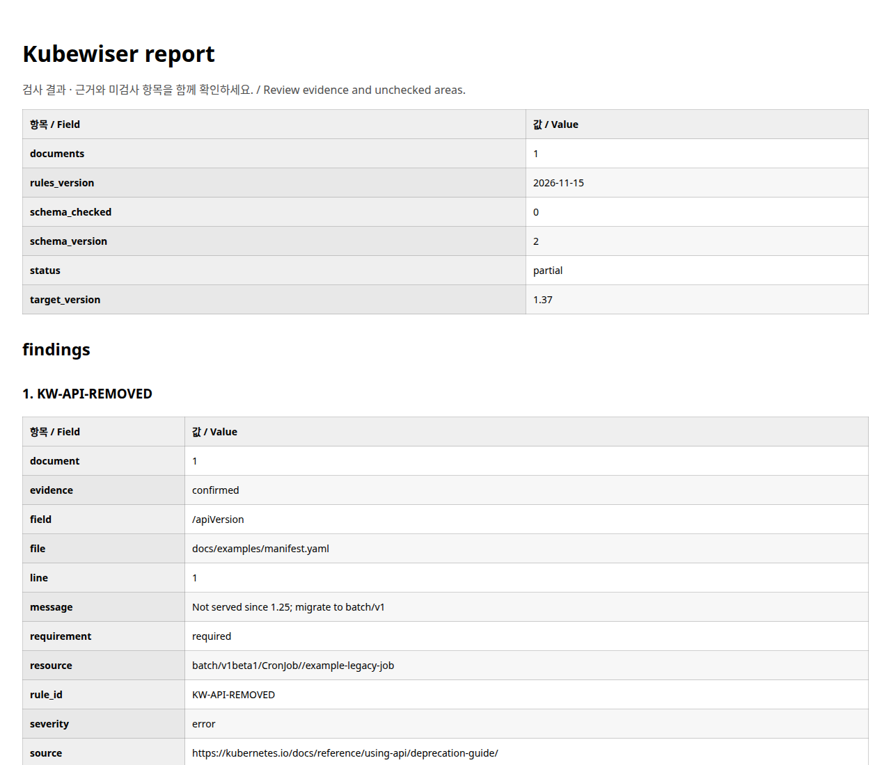

# kubewiser

**English** | [한국어](README.ko.md)

Evidence-oriented Kubernetes inspection CLI and local MCP server. Both `kubewiser` and `kubewise` run the same engine. Analysis is offline; only an explicit `collect` command (or explicitly enabled MCP collection) contacts your selected Kubernetes API server. No telemetry, automatic update checks, document downloads, cloud API calls or resource mutations.

## Download and install

[GitHub Releases](https://github.com/uknowpro/kubewiser/releases) provides Linux/macOS amd64 and arm64, Windows 10+ amd64 and 386 builds. **End users do not need Go, Helm, kubectl or WSL.** Windows ZIPs contain one EXE; `install.ps1` registers both commands using hardlinks to one executable. See [installation instructions](docs/releases.md), including native test limitations and checksums.

## Implemented inspection paths

| Area | Implemented | Boundary |
| --- | --- | --- |
| Versioned validation | Embedded official Kubernetes 1.16–1.37 `.0` schemas; unknown fields, types and schema-required fields; local CRDs; deprecated/removed API rules | Schema validation is not admission validation or a guarantee of workload compatibility |
| Collection | Explicit context/namespace; sequential GETs, pagination, request/time/item limits; gaps and redacted paths | Fixed resource allowlist; no Secrets/custom resources; no exec/cloud auth plugins |
| Helm and drift | Local vendored chart rendering; target capabilities; source hashes; snapshot comparison with named-list normalization | No install, dependency downloads, live lookup, values.schema.json validation or inferred field ownership |
| Upgrade planning | Minor-by-minor steps, required/conditional actions, kubelet skew evidence and dependency recommendations | Vendor matrices, behavior changes and real application tests require separate validation |
| Network and migration | NetworkPolicy isolation intent, Ingress/Service exposure, existing Hubble NDJSON; EKS/AKS/GKE dependency actions | No active probes, firewall reachability proof, infrastructure generation or stateful data migration |

See [official sources and coverage](docs/official-sources.md), [operational details](docs/operations.md) and [remaining roadmap](docs/roadmap.md).

## HTML report preview

A real browser screenshot of the [generated HTML report](docs/examples/report.html), showing the summary and an API-removal finding. The full report continues below the viewport. Download the HTML and open it locally; GitHub displays its source.



[Markdown example](docs/examples/report.md) · [Example input](docs/examples/manifest.yaml)

## Command reference

Every `kubewiser` command also works as `kubewise`. Put flags before positional paths. Run the checked-in `docs/examples/...` examples from the repository root. Replace example paths, context and namespace when using your own inputs. Fixtures are synthetic documentation data; `snapshot.json` contains one Service and is not a production snapshot. Terminal excerpts below come from actual local CLI runs. `echo $?` is the POSIX shell exit-code check; in PowerShell use `$LASTEXITCODE`. MCP is a waiting server, not a report-producing command.

### Output formats and saving reports

Markdown and HTML require v0.2.0-alpha.2 or newer.

| Format | Purpose | Example |
| --- | --- | --- |
| `json` (default) | Automation and structured processing | `--format json ... > report.json` |
| `text` | Concise terminal summary for direct scan reports | `--format text ...` |
| `markdown` | Tables and lists for GitHub or editors | `--format markdown ... > report.md` |
| `html` | Standalone browser report, including printing | `--format html ... > report.html` |

Concise text applies to `scan files` and `scan snapshot`; other results remain JSON with `--format text`. Markdown/HTML work for scan, diff, plan and collection summaries. `versions` supports json/markdown/html. MCP always uses structured protocol responses.

```sh
kubewiser scan files --target-version 1.37 --format markdown docs/examples/manifest.yaml > report.md
kubewiser scan files --target-version 1.37 --format html docs/examples/manifest.yaml > report.html
```

```powershell
# Windows PowerShell: preserve Unicode as UTF-8
kubewiser scan files --target-version 1.37 --format html .\deploy | Out-File -Encoding utf8 report.html
Start-Process .\report.html
```

HTML includes its CSS and loads no external fonts, scripts or images. Both readable formats retain the JSON report's evidence and unchecked areas and escape input-controlled markup. Reports can still contain sensitive paths, resource names and metadata. Redirection is silent on success: open the saved file to view it. Findings can produce exit code 1 while still saving a complete report.

### `--help`, `--version`, `versions` — inspect commands and supported versions

`--version` identifies the binary; `versions` lists embedded schema versions, official source URLs, hashes and review dates. A 1.37.x target uses the bundled 1.37.0 schema.

**Terminal example** — Long JSON is excerpted to selected fields. Actual output includes additional evidence and unchecked areas.

```console
$ kubewiser --help
Commands: kubewiser or kubewise
  --version
  versions [--format json|markdown|html]
  scan files --target-version VERSION [--recommend] PATH
  scan helm --target-version VERSION --release NAME --namespace NS [--values FILE] CHART
...
$ echo $?
0
```

**Terminal example** — Actual output from a local development build. Release binaries display their own version, commit and platform.

```console
$ kubewiser --version
kubewiser dev (commit unknown; linux/amd64)
$ echo $?
0
```

**Terminal example** — Long JSON is excerpted to selected fields. Actual output includes additional evidence and unchecked areas.

```console
$ kubewiser versions
[
  {
    "version": "v1.16.0",
    "source": "https://raw.githubusercontent.com/kubernetes/kubernetes/v1.16.0/api/openapi-spec/swagger.json",
    "reviewed": "2026-11-15"
  }
]
$ echo $?
0
```
### `scan files` — validate YAML/JSON manifests

Inspect a file or directory recursively for schema errors and API deprecation/removal. Add `--recommend` for conditional readiness/resource recommendations. Supply CRDs alongside custom resources to use local schemas. Review `findings`, source positions, `requirement`, `severity`, `source` and `schema_checked`.

**Terminal example** — Long JSON is excerpted to selected fields. Actual output includes additional evidence and unchecked areas.

```console
$ kubewiser scan files --target-version 1.37 --format text docs/examples/manifest.yaml
Resources: 1 | Schema-checked: 0 | Findings: 1 | Coverage: partial
KW-API-REMOVED docs/examples/manifest.yaml:1 /apiVersion required: Not served since 1.25; migrate to batch/v1
UNCHECKED: Admission, CEL, controller behavior, feature-gate availability and application runtime compatibility are not evaluated
UNCHECKED: OpenAPI validation does not replace Kubernetes admission or server semantic validation
UNCHECKED: Schemas are pinned to minor .0 releases; patch-specific changes are not inferred
$ echo $?
1
```
### `scan helm` — render and inspect a local chart

Use an unpacked chart with dependencies already vendored locally. `--release`, `--namespace` and optional `--values` fix rendering inputs. No Helm installation, dependency downloads, live lookup or apply is performed. `render` records chart metadata/capabilities; `report` contains findings. `--api-versions` replaces the entire default capability list. Helm values.schema.json validation is skipped.

**Terminal example** — Long JSON is excerpted to selected fields. Actual output includes additional evidence and unchecked areas.

```console
$ kubewiser scan helm --target-version 1.37 --release app --namespace team docs/examples/chart
{
  "render": {
    "chart": "demo",
    "chart_version": "0.1.0",
    "release": "app",
    "namespace": "team",
    "target_version": "1.37"
  },
  "report": {
    "documents": 1,
    "schema_checked": 1,
    "findings": [],
    "status": "partial"
  }
}
$ echo $?
0
```

Additional usage with your own inputs:

```sh
kubewiser scan helm --target-version 1.37 --release app --namespace team --values ./values.yaml --format html ./chart > helm-report.html
```
### `collect` — create a read-only snapshot

Requires explicit `--kubeconfig`, `--context`, `--namespace` and a new `--output` file. This command contacts the selected API server. The output file is always a JSON snapshot; stdout is a summary whose presentation can be Markdown/HTML. Existing snapshots are never overwritten. Secrets are excluded and selected sensitive fields are removed. Exec authentication plugins are not supported. Defaults and allowlists are in [operational details](docs/operations.md).

**Terminal example** — Captured against an empty loopback mock API server, not a real cluster. Only the temporary output path is shown as snapshot.json.

```console
$ kubewiser collect --kubeconfig ./config --context demo --namespace team --qps 10 --output snapshot.json
{
  "gaps": [
    {
      "resource": "coverage",
      "reason": "Secrets, custom resources, unlisted kinds and other namespaces are not collected"
    }
  ],
  "output": "snapshot.json",
  "redacted_fields": 0,
  "requests": 13,
  "resources": 0
}
$ echo $?
0
```

Additional usage with your own inputs:

```sh
kubewiser collect --kubeconfig ./config --context staging --namespace team --include-cluster-resources --qps 1 --max-items 3000 --timeout 3m --output ./snapshot-with-nodes.json --format markdown > collection-summary.md
```
### `scan snapshot` — inspect saved resources

Validate a saved snapshot against a target version without reconnecting to the cluster. Collection gaps and redacted fields appear in `unchecked`. Resources absent from the snapshot have not been validated.

**Terminal example** — Long JSON is excerpted to selected fields. Actual output includes additional evidence and unchecked areas.

```console
$ kubewiser scan snapshot --target-version 1.37 --format text docs/examples/snapshot.json
Resources: 1 | Schema-checked: 1 | Findings: 0 | Coverage: partial
UNCHECKED: Admission, CEL, controller behavior, feature-gate availability and application runtime compatibility are not evaluated
UNCHECKED: OpenAPI validation does not replace Kubernetes admission or server semantic validation
UNCHECKED: Schemas are pinned to minor .0 releases; patch-specific changes are not inferred
UNCHECKED: coverage: Synthetic documentation fixture: only one Service included
UNCHECKED: Redacted fields may not be schema-validated
$ echo $?
0
```
### `diff` — compare desired and observed state

Use exactly one of `--source` or `--chart`, plus `--snapshot`. Namespace defaults to the snapshot namespace. `changed` means differing values (values are omitted); `desired_only_field`/`observed_only_field` indicate fields present on one side. Observed-only fields can be defaults or controller additions. `not_observed` may reflect missing collection scope or permissions. `observed_only_resource` is not a deletion recommendation. `conversion_unverified` means API-version conversion is needed.

**Terminal example** — Long JSON is excerpted to selected fields. Actual output includes additional evidence and unchecked areas.

```console
$ kubewiser diff --source docs/examples/desired.yaml --snapshot docs/examples/snapshot.json
{
  "changes": [
    {
      "resource": "/Service/team/web",
      "path": "/spec/ports",
      "type": "changed",
      "message": "Declared and observed values differ; values omitted"
    }
  ]
}
$ echo $?
1
```

Additional usage with your own inputs:

```sh
kubewiser diff --chart ./chart --target-version 1.37 --release app --values ./values.yaml --snapshot ./snapshot.json --format html > drift.html
```
### `plan upgrade` — list upgrade actions

Specify an increasing minor-version range with `--from`/`--to` and exactly one of `--source` or `--snapshot`. `steps` lists minor-by-minor progression; `actions` includes requirements, verification and evidence. Node inputs enable kubelet skew checks. Add-on, application and kernel compatibility still require separate validation.

**Terminal example** — Long JSON is excerpted to selected fields. Actual output includes additional evidence and unchecked areas.

```console
$ kubewiser plan upgrade --source docs/examples/manifest.yaml --from 1.24 --to 1.26
{
  "kind": "upgrade",
  "from": "1.24",
  "to": "1.26",
  "steps": [
    "1.25: verify provider/add-on prerequisites, upgrade control plane, then compatible node components, then validate workloads",
    "1.26: verify provider/add-on prerequisites, upgrade control plane, then compatible node components, then validate workloads"
  ],
  "actions": [
    {
      "id": "KW-API-REMOVED",
      "resource": "batch/v1beta1/CronJob//example-legacy-job",
      "requirement": "required",
      "message": "Not served since 1.25; migrate to batch/v1",
      "verification": "Re-run target validation and test workload behavior in staging",
      "source": "https://kubernetes.io/docs/reference/using-api/deprecation-guide/",
      "before_version": "1.26"
    }
  ]
}
$ echo $?
0
```

Additional usage with your own inputs:

```sh
kubewiser plan upgrade --snapshot ./snapshot-with-nodes.json --from 1.35 --to 1.37 --format html > upgrade-plan.html
```
### `scan network` — inspect intent and existing flows

Read manifests or a snapshot; optionally supply existing Hubble JSON Lines with `--flows`. `exposures` shows configured exposure, `isolation` shows policy isolation intent and `observed_flows` aggregates observed endpoints, verdicts and times. No probes or agents are started. Configured or observed connectivity is not a reachability guarantee.

**Terminal example** — Long JSON is excerpted to selected fields. Actual output includes additional evidence and unchecked areas.

```console
$ kubewiser scan network --snapshot docs/examples/snapshot.json --flows docs/examples/hubble.jsonl
{
  "exposures": [
    {
      "resource": "v1/Service/team/web",
      "type": "LoadBalancer",
      "evidence": "configured exposure, not reachability tested"
    }
  ],
  "observed_flows": [
    {
      "source": "team/web",
      "destination": "team/db",
      "verdict": "FORWARDED",
      "count": 1,
      "first_observed": "2026-11-15T00:00:00Z",
      "last_observed": "2026-11-15T00:00:00Z"
    }
  ]
}
$ echo $?
0
```

Additional usage with your own inputs:

```sh
kubewiser scan network --namespace team --format markdown ./deploy > network-policy.md
```
### `plan migrate` — inventory cloud dependencies

Choose distinct providers from `eks`, `aks`, `gke` using `--from`/`--to`. Review storage, load balancing, workload identity and platform-specific settings. No cloud API calls, provisioning, template generation or data movement occurs. Original manifests retain provider annotations that snapshots redact.

**Terminal example** — Long JSON is excerpted to selected fields. Actual output includes additional evidence and unchecked areas.

```console
$ kubewiser plan migrate --source docs/examples/desired.yaml --from eks --to aks
{
  "kind": "migration",
  "from": "eks",
  "to": "aks",
  "actions": [
    {
      "id": "KW-MIGRATE-LB",
      "resource": "v1/Service/team/web",
      "requirement": "required",
      "message": "Recreate provider load balancer configuration, annotations and health checks; verify client IP and exposure",
      "verification": "Validate target provider configuration and test in staging before cutover",
      "source": "https://learn.microsoft.com/en-us/azure/aks/what-is-aks"
    }
  ]
}
$ echo $?
0
```

Additional usage with your own inputs:

```sh
kubewiser plan migrate --snapshot ./snapshot.json --from aks --to gke --format html > migration-plan.html
```

### `mcp` — serve tools to a local model client

```console
$ kubewiser mcp --input docs/examples/desired.yaml --snapshot docs/examples/snapshot.json --namespace team
```

No banner or report is printed while waiting for MCP requests. Configure an MCP-capable client to launch the command, or press Ctrl+C to stop a manual session. Do not redirect it to report.md. Add fixed `--chart`, `--values` and `--flows` paths to enable those inputs. See the local-model details below.

### Interpreting results and exit codes

| Field | Meaning |
| --- | --- |
| `required` | Required action |
| `conditional` | Act when the stated condition applies |
| `optional` | Recommendation based on measured operational needs |
| `severity` | Error/warning severity, separate from requirement |
| `source` / `evidence` | Documentation source and evidence level |
| `unchecked` / `gaps` | Unvalidated areas and collection gaps |
| `status: partial` | Limited inspection coverage, not full compatibility assurance |

Scan exits with `0` for no findings, `1` for findings and `2` for argument/operational errors. Diff returns `1` for changes. Successful collect/plan/network commands return `0` even with actions or gaps. **Exit 0 does not prove compatibility.** Findings exit code 1 still produces reports. Shell `>` overwrites existing report files; choose filenames accordingly.

## Local MCP and local models

```sh
kubewiser mcp --input /absolute/path/deploy --snapshot /absolute/path/snapshot.json
```

An MCP-capable client can connect a local DeepSeek/Ollama model to this stdio server. Kubewiser does not launch or call an LLM. Tools: `scan_files`, `plan_upgrade`, `plan_migrate`, `scan_network`; `compare_drift` requires input and snapshot, `scan_helm` requires `--chart`. Paths and cluster scope are fixed by the operator at startup, not chosen by the model. Use `--namespace` when the desired manifests omit it.

Collection is absent by default. Enabling `--allow-cluster` also requires explicit `--kubeconfig`, `--context`, `--namespace`; collection returns a redacted snapshot to the MCP client. The client/model can transmit received data: use a local-only client configuration if external transmission is prohibited. Paths, hashes, resource names, IPs and remaining snapshot metadata can still be sensitive. Treat chosen charts and manifests as trusted local inputs.

## Build and development

Requires Go 1.26+; CI pins the toolchain in `.go-version`. Runtime binaries require no Go installation.

```sh
go build -o kubewiser ./cmd/kubewiser
go test -race ./...
go vet ./...
```

Third-party dependencies and embedded official schemas are covered by [THIRD_PARTY_NOTICES.txt](THIRD_PARTY_NOTICES.txt). Reports use format v2; consumers of earlier alpha reports must update their parsers.
