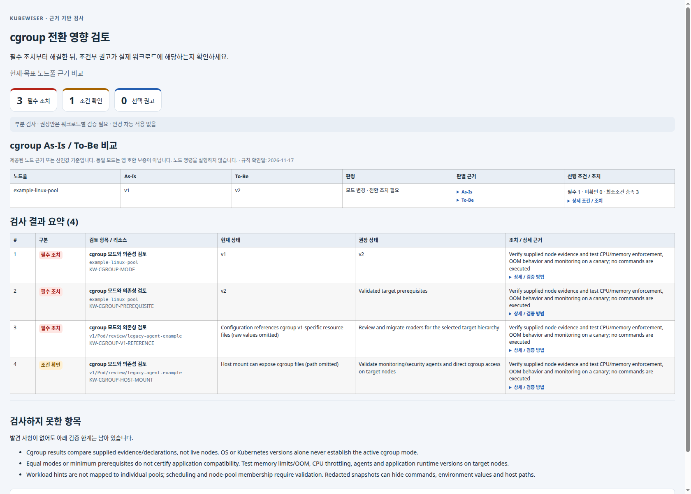

# Cgroup comparison / cgroup 비교

Available from **v0.2.0-alpha.8**. Compare supplied current/target Linux node-pool evidence, validate selected prerequisites and identify manifest-level dependency hints. No SSH, kubectl exec/debug, host inspection, agent installation or cloud request is performed by these commands.

```sh
kubewiser scan cgroup --source ./deploy --cgroup-evidence ./pools.json \
  --target-version 1.36 --format html --lang ko > cgroup.html
kubewiser plan upgrade --snapshot ./snapshot.json --from 1.21 --to 1.36 \
  --cgroup-evidence ./pools.json --format html --lang ko > upgrade.html
```

Use [the synthetic pool evidence](examples/cgroup/pools.json) and [workload](examples/cgroup/workload.yaml) as field examples. They are not measurements of your cluster. `pools.json` is an array of up to 100 uniquely named pools, each with `current` and `target`:

```json
[
  {
    "name": "linux-pool",
    "current": {
      "mode": "v1",
      "evidence": "Operator-reviewed current node inventory; replace with actual provenance"
    },
    "target": {
      "mode": "v2",
      "evidence": "Approved target node-pool specification; validate on a canary",
      "kernel": "6.8.0-azure",
      "runtime": "containerd",
      "runtime_version": "2.0.0",
      "kubelet_driver": "systemd",
      "runtime_driver": "systemd"
    }
  }
]
```

For `plan aks`, put this array in the project profile's `cgroup_pools` field. The normal `from_version`/`to_version` still control Kubernetes versions. MCP `scan_cgroup` uses the operator-fixed profile and input paths. `--cgroup-evidence` is accepted only by `scan cgroup` and `plan upgrade`; AKS uses the profile to avoid conflicting inputs.



## Evidence classification

- Explicit `mode` accepts `v1`, `v2`, `hybrid`, `unknown`; known declarations require an `evidence` description. These are operator declarations, not live verification.
- A supplied `root_fs_type: cgroup2fs` with `scope: node` identifies v2. `tmpfs` alone remains unknown because it does not distinguish v1 from a hybrid hierarchy.
- Optional `mountinfo` contains locally exported Linux mountinfo text. With `scope: node`, cgroup mounts under `/sys/fs/cgroup` identify v1, cgroup2 mounts identify v2, both identify hybrid. A partial export can misclassify the hierarchy: supply the complete host mount namespace and verify provenance.
- `scope: container` or missing scope does not establish node mode from filesystem observations. OS version, Kubernetes version, image tag and `systemd` driver alone are not mode evidence.
- Contradictory declarations and observations produce `conflicting_evidence`. Raw mountinfo is not copied into results, including AKS profile metadata; its hash is recorded when used. User-supplied descriptions and other profile values are not universal secret-redacted fields.
- Evidence does not independently establish node identity, freshness or coverage. Pool names are supplied identifiers, not automatic scheduling links. Windows cgroups are outside this Linux-only analysis.

If your approved operational procedure allows it, an operator can inspect the **node host** using the read-only commands `stat -fc %T /sys/fs/cgroup/` and `cat /proc/self/mountinfo`, and supply the results. kubewiser never runs those commands. Running them inside an arbitrary container measures that namespace, not necessarily the host.

## Comparison and actions

HTML has a separate As-Is/To-Be table per pool with evidence and prerequisites. Results distinguish `mode_change`, `same_mode`, `unknown`, `conflicting_evidence`, and `hybrid_review`. Equal modes and satisfied minimums are not application compatibility approvals.

Selected checks include:

- Target v2: documented baseline kernel 5.8+, containerd 1.4+ or CRI-O 1.20+, effective kubelet/runtime systemd drivers. Missing or unrecognized values remain unchecked; meeting minimums does not establish current vendor support or exact Kubernetes compatibility.
- Kubernetes 1.35+: v1 is deprecated and kubelet refuses v1 by default. Results require reviewing actual `failCgroupV1`/provider policy, not automatically setting an override.
- v1/v2 changes: hierarchy, memory resource files and CPU quota interface; test limits, OOM and throttling behavior. Validate JVM, Node.js, Go automaxprocs, monitoring and security agents where used. Their actual versions and binary behavior are not inferred from image names.
- Workload hints: cgroup v1 filenames in declared commands/args/literal environment values; hostPath mounts that expose the cgroup filesystem or its ancestors. These are static hints, not proof of executed access. Raw matching values/host paths are omitted from findings.

`scan cgroup` returns 1 when review actions exist (including a same-mode review), 0 only when no actions exist, and 2 for invalid input. Plan commands retain their existing exit semantics. JSON contains the `cgroup` comparisons plus actions; text/Markdown contain the same mode decisions and verification actions. Default upgrade/AKS plans show missing evidence explicitly rather than silently omitting cgroups.

## 한국어

- 현재와 목표 cgroup을 실제로 비교해 전환 필요·동일 모드·미확인·근거 충돌·혼합 계층으로 판정합니다.
- Kubernetes 버전만 입력했다고 노드 모드까지 확인되는 것은 아닙니다. `--cgroup-evidence` 또는 AKS 프로필 `cgroup_pools`에 노드풀별 근거를 제공하세요.
- 모드 전환뿐 아니라 대상 커널·런타임·드라이버 조건, v1 전용 파일 참조, 호스트 마운트도 결과에 포함합니다.
- Java 등의 앱 버전은 이미지 이름으로 추측하지 않습니다. 대상 노드에서 메모리 제한·OOM·CPU throttling·에이전트 동작 검증이 필요합니다.
- [예제 HTML](examples/cgroup/report.ko.html)은 합성 입력입니다. 실제 노드 접속·변경 없이 생성했습니다.

## Official sources reviewed 2026-11-17

- [Kubernetes cgroup v2 requirements, migration and identification](https://kubernetes.io/docs/concepts/architecture/cgroups/)
- [Kubernetes cgroup v2 transition and v1 deprecation](https://kubernetes.io/blog/2026/10/06/kubernetes-cgroups-v2-shift/)
- [AKS application memory issues after an OS/cgroup transition](https://learn.microsoft.com/en-us/troubleshoot/azure/azure-kubernetes/aks-memory-saturation-after-upgrade)
