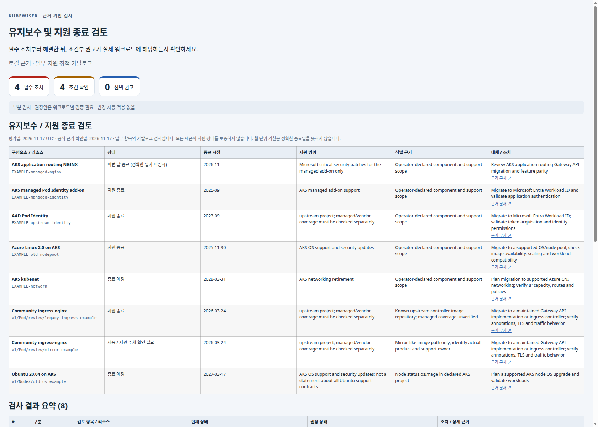

# Support lifecycle checks / 지원 종료 검사

Available from **v0.2.0-alpha.7**. This is an offline, selected catalog check, not a full software asset or vulnerability scanner. No cloud/vendor API calls, image pulls or automatic updates occur.

```sh
kubewiser scan lifecycle --source ./deploy --format html --lang ko > lifecycle.html
kubewiser scan lifecycle --snapshot ./snapshot.json --profile ./project.json --format markdown > lifecycle.md
kubewiser plan aks --source ./deploy --profile ./project.json --format html --lang ko > upgrade.html
```

Upgrade and AKS plans include lifecycle results automatically. `scan lifecycle` returns 1 for review findings (including identification hints and future deadlines), 0 for no catalog matches, and 2 for invalid inputs. A zero exit code never certifies support. MCP `scan_lifecycle` uses operator-fixed inputs and an optional fixed project profile.



## Catalog reviewed 2026-11-17

| Profile component ID | Support scope | End date / month | Evidence |
| --- | --- | --- | --- |
| `ingress-nginx` | Community upstream project | 2026-03-24 | [Kubernetes announcement](https://kubernetes.io/blog/2026/04/22/kubernetes-v1-36-release/) |
| `aks-app-routing-nginx` | Microsoft critical security patch coverage for managed application routing NGINX | 2026-11 | [AKS migration](https://learn.microsoft.com/en-us/azure/aks/app-routing-nginx-to-gateway-api-migration) |
| `aad-pod-identity` | Upstream AAD Pod Identity | 2023-09 | [Project retirement](https://github.com/Azure/aad-pod-identity) |
| `aks-pod-identity` | AKS managed Pod Identity add-on | 2025-09 | [Microsoft support scope](https://learn.microsoft.com/en-us/azure/aks/use-azure-ad-pod-identity) |
| `aks-azurelinux2` | Azure Linux 2.0 support/security updates on AKS | 2025-11-30 | [AKS OS support](https://learn.microsoft.com/en-us/azure/aks/upgrade-os-version) |
| `aks-ubuntu2004` | Ubuntu 20.04 support/security updates on AKS | 2027-03-17 | [AKS OS support](https://learn.microsoft.com/en-us/azure/aks/upgrade-os-version) |
| `aks-kubenet` | AKS kubenet retirement | 2028-03-31 | [AKS networking](https://learn.microsoft.com/en-us/azure/aks/configure-kubenet) |

Dates are compared with the executing machine's UTC date, recorded as `evaluated_at`. Month-only announcements remain `ending_this_month` during that month; they become `ended` the following month. No exact day is invented. Day-specific announcements are marked ended on the listed date. Future entries are `scheduled`. Catalog review time is separate from evaluation time: policies may change, and the program does not fetch updates.

## Identification and managed support

Known official/current/legacy ingress-nginx image repositories are recognized regardless of tags or digests. AAD Pod Identity images and `aadpodidentity.k8s.io` resources identify upstream dependencies. Mirror-like image paths and the `app.kubernetes.io/name=ingress-nginx` label only produce `identification_required`, not a definitive retirement finding. F5 NGINX is not identified merely because an image contains the word nginx. Arbitrarily renamed mirror images may not be recognized at all.

AKS-specific Node OS checks require a project declaring `provider: aks`, plus matching `status.nodeInfo.osImage`. Generic CBL-Mariner identity without an exact version remains uncertain. Missing Nodes/OS evidence is not proof of a supported OS. These are AKS policies, not generic Ubuntu/enterprise support-contract judgments.

Managed ingress support, kubenet and other dependencies that cannot be established from the resource set can be declared in the existing AKS project profile:

```json
"lifecycle_components": [
  {"id": "aks-app-routing-nginx", "resource": "apps/v1/Deployment/app-routing-system/nginx"},
  {"id": "aks-kubenet", "resource": "cluster-network"}
]
```

Use the exact report resource ID when associating managed support with an observed controller. For the same resource ID, an explicit `aks-app-routing-nginx` or `aks-pod-identity` declaration replaces the corresponding upstream-only assessment. This is operator-supplied evidence, not independent proof that Microsoft manages the component. Unknown IDs and duplicate entries are rejected. Incorrect declarations can produce incorrect scope; verify the actual deployment and support owner.

[Synthetic project inventory](examples/lifecycle-project.json) demonstrates all seven scopes; replace it with verified inventory before reviewing real workloads.

## Reports and coverage

HTML includes a separate table: component/resource, status, end date, support scope, identification evidence, replacement/action and official reference. JSON contains `lifecycle` alongside the normal actions; Markdown/text include action evidence. Existing version-removal checks remain separate: dockershim removal in 1.24 and PodSecurityPolicy removal in 1.25 are version events, not support-calendar dates.

There is no promise to cover every CNI/CSI, database, runtime, Helm chart, application image or vendor release. Additions require official scope/date evidence and regression tests. A compatible Kubernetes version matrix is not a maintenance guarantee.

## 한국어

- `scan lifecycle`로 별도 검사하며, `plan upgrade`와 `plan aks`에는 자동 포함됩니다. 로컬 파일·스냅샷만 읽습니다.
- **지원 종료 / 종료 예정 / 이번 달 종료 / 제품·지원 주체 확인 필요**를 구분합니다. 월만 공지된 일정은 일자를 임의로 만들지 않습니다.
- 커뮤니티 프로젝트와 AKS 관리형 지원은 별도 범위입니다. 관리형 여부는 프로필의 `lifecycle_components`로 명시해야 하며 실제 관리 주체를 자동 확인하지 않습니다.
- 사설 이미지 경로·레이블은 단서입니다. 동일한 제품으로 확정하거나 종료로 단정하지 않습니다. 완전히 다른 이름으로 복제한 이미지는 누락될 수 있습니다.
- AKS OS 판정에는 AKS 프로필과 Node OS 정보가 필요합니다. kubenet은 명시적 인벤토리로 선언합니다.
- 모든 제품을 검사하는 기능은 아닙니다. 카탈로그 미일치·수집 누락·프로필 미제공은 지원 중이라는 뜻이 아닙니다.
- [예제 입력](examples/lifecycle.yaml)과 [생성된 한국어 HTML 예시](examples/lifecycle.ko.html)는 합성 자료이며 운영 클러스터 검사 결과가 아닙니다.
